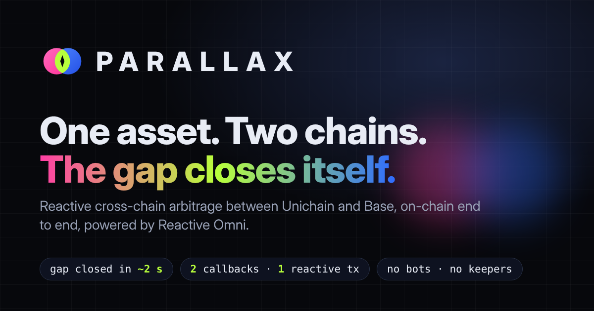
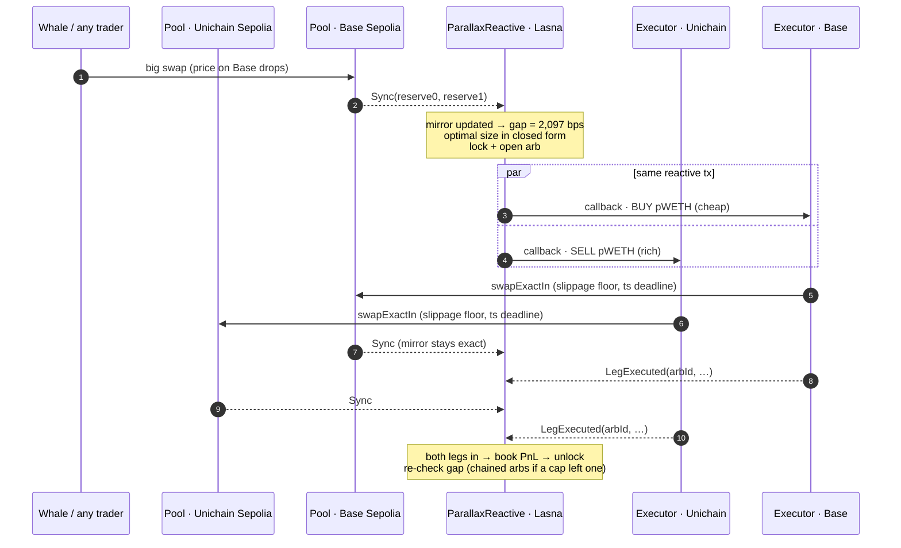

# PARALLAX

### Reactive cross-chain arbitrage. One asset, two chains, and the price gap closes itself in seconds.

> **Reactive Omni Buildathon · Track: Every Second Counts** · Unichain Sepolia + Base Sepolia + Reactive Lasna

<p align="center"></p>

**🌐 Live site:** _add your Vercel link here_ · **📊 Dashboard:** `/app.html` · **🎬 Demo video:** _add link_

## It's live: verified on-chain

**2 arbitrages, both directions, 4 of 4 legs filled, +1,341.08 pUSD realised, each gap closed in about 2 seconds.**

| Contract | Chain | Address |
|---|---|---|
| ParallaxReactive (brain) | Reactive Lasna | [`0x7CF7EAa45e9AD5a2CAe51B249C2722EFAD001ba2`](https://lasna.reactscan.net/address/0x7CF7EAa45e9AD5a2CAe51B249C2722EFAD001ba2) |
| ParallaxPair | Unichain Sepolia | [`0x17fe4Fb050f91BaB81860632Ed1cF5d979C54833`](https://sepolia.uniscan.xyz/address/0x17fe4Fb050f91BaB81860632Ed1cF5d979C54833) |
| ParallaxExecutor | Unichain Sepolia | [`0xf5b85531bE66956F169735E0745e4644d2EA43ee`](https://sepolia.uniscan.xyz/address/0xf5b85531bE66956F169735E0745e4644d2EA43ee) |
| ParallaxPair | Base Sepolia | [`0x2a32d205717280610E197951b07ba51Aa5510b76`](https://sepolia.basescan.org/address/0x2a32d205717280610E197951b07ba51Aa5510b76) |
| ParallaxExecutor | Base Sepolia | [`0xa3A640A2bD7c1cC3dCad9b5D9e58Fa36F7997A14`](https://sepolia.basescan.org/address/0xa3A640A2bD7c1cC3dCad9b5D9e58Fa36F7997A14) |

**ARB #1: buy on Base → sell on Unichain** · gap 1,878 bps → 58 bps · size 11,459 pUSD · **+992.33 pUSD** (exactly as predicted) · settled in 2 s

| Step | Chain | Tx |
|---|---|---|
| ① Whale swap emits `Sync` | Base Sepolia | [`0x17be3a98…51c497`](https://sepolia.basescan.org/tx/0x17be3a987eb44f0387b5bfba52add8b798c4c4ff693f2de2ede8bdd34651c497) |
| ② `react()` → 2 callbacks in one tx | Reactive Lasna | [`0xa2288808…a8d2f0`](https://lasna.reactscan.net/tx/0xa22888086795a473ea2f962bf1e860596db68753a101f23eeee5f422afa8d2f0) |
| ③ Buy leg: bought 4.343 pWETH (+1 s) | Base Sepolia | [`0x32b8b734…3ea8b8`](https://sepolia.basescan.org/tx/0x32b8b73472897e14f4a990ea6fff61e4471504414f356b0ee5a5b5b2be3ea8b8) |
| ④ Sell leg: sold 4.343 pWETH (+2 s) | Unichain Sepolia | [`0x399a2f4f…24f6cc`](https://sepolia.uniscan.xyz/tx/0x399a2f4f49c82a3439ed166ad4c55786a1062fa0ffab8e5cde640b2f5224f6cc) |

**ARB #2: buy on Unichain → sell on Base** · gap 1,117 bps → 59 bps · size 6,810 pUSD · **+348.75 pUSD** (exactly as predicted) · settled in 2 s

| Step | Chain | Tx |
|---|---|---|
| ① Whale swap emits `Sync` | Unichain Sepolia | [`0x02c2e99d…d52f30`](https://sepolia.uniscan.xyz/tx/0x02c2e99d5a9a8ce87ab82d5fd5ab0e1cb24b00856fb4005b68c13b7d7dd52f30) |
| ② `react()` → 2 callbacks in one tx | Reactive Lasna | [`0x9c609623…0a8b5f`](https://lasna.reactscan.net/tx/0x9c609623138c429c936dc1e8b195bf7131ed81581d01f21e177bdf7c0a0a8b5f) |
| ③ Buy leg: bought 2.688 pWETH (+2 s) | Unichain Sepolia | [`0x4cd9d6d2…f4eb53`](https://sepolia.uniscan.xyz/tx/0x4cd9d6d2dcd6098df99a6be30111eccb021861af2b0da5f567f47a162af4eb53) |
| ④ Sell leg: sold 2.688 pWETH (+1 s) | Base Sepolia | [`0x2220a3f7…48125f`](https://sepolia.basescan.org/tx/0x2220a3f75c209dd07dabe5d3501ab00d895bb47e5e693fdd12ae1322dd48125f) |

The settlement (`LegConfirmed` ×2 + `ArbSettled`) is recorded in later reactive transactions on the brain's [Lasna page](https://lasna.reactscan.net/address/0x7CF7EAa45e9AD5a2CAe51B249C2722EFAD001ba2).

From two places, the same object looks like it sits in two different spots. That shift is called parallax.
Markets do the same thing: the same token trades at one price on Unichain and at another on Base. Whoever closes
that gap first keeps the profit. Usually that's a bot farm with private RPCs and servers watching both chains.

**Parallax closes the gap without any of that.** A reactive contract on Reactive Network keeps a live copy of both
markets. When the price gap is big enough to pay for the fees, it **fires a buy on the cheap chain and a sell on the
expensive chain in the same reactive transaction**. It works out the trade size on-chain, tracks both legs until they
finish, records the PnL, and checks the gap again. There are no bots, no keepers and no off-chain servers.

On the old ~7 s blocks this strategy didn't work, because the gap was gone before the reaction landed. With **Omni's
~1 s blocks and instant finality**, the loop from the origin swap to both callbacks finishes within a few seconds.

---

## The loop



Each arb leaves a full on-chain trail that you can click through on the dashboard:
**origin swap tx → reactive tx (2 callbacks) → buy-leg tx → sell-leg tx → settlement event**.

## Why the reactive contract does real work

| Responsibility | Where it lives |
|---|---|
| Live copy of **two markets on two chains** (any Uniswap-V2-style `Sync`) | `ParallaxReactive._onSync` |
| Cross-chain price comparison, rounding-free (cross-multiplication) | `ParallaxMath.spreadBps` |
| **Profit-maximising trade size, closed form** (two chained constant-product pools → one virtual pool, `dx* = (√(γ·e0·e1) − e0)/γ`) | `ParallaxMath.optimalArbInput` |
| Fee-aware go / no-go, max-size cap, min-profit floor | `previewArb` / `_evaluate` |
| **Two coordinated callbacks in one reactive tx**, each with its own minOut + deadline | `_requestLeg` ×2 |
| In-flight lock with timestamp expiry, so it never double-fires on its own Syncs | `activeArbId`, `lockTimeout` |
| **Closed feedback loop**: subscribes to the executors' `LegExecuted` / `LegSkipped` | `configureExecutors`, `_onLeg` |
| Realised PnL + inventory-drift accounting, chained re-arbs | `_settle` |
| **Circuit breaker**: 2 partial fills in a row pause the engine | `MAX_CONSECUTIVE_PARTIAL_FILLS` |

Take the reactive contract away and nothing is left: no bot, no server, no keeper.

## Contracts

| Contract | Chain | What it does |
|---|---|---|
| `src/ParallaxReactive.sol` | Reactive Lasna (5318007) | The brain: mirror, size, fire, track, settle |
| `src/ParallaxExecutor.sol` | Unichain Sepolia (1301) + Base Sepolia (84532) | Callback contract holding inventory. It re-quotes, enforces guards and swaps |
| `src/amm/ParallaxPair.sol` | both origin chains | 0.30% constant-product pool that emits the **exact Uniswap V2 `Sync`** event |
| `src/amm/ParallaxToken.sol` | both origin chains | pWETH / pUSD test tokens (open mint, so anyone can play whale) |
| `src/ParallaxMath.sol` | library | AMM math, optimal arbitrage size, spread, sqrt |

### Safety rails on every leg (enforced on the destination chain)
- Only the Reactive **callback proxy** can call, and only for **our** reactive contract (`onlyServiceProvider` + `onlyCallbackSender`).
- **Replay protection**: each `arbId` runs at most once per executor.
- **Timestamp deadline and timestamp cooldown**, never block counts. Base Sepolia makes a block every 200 ms, and this follows the buildathon rule.
- **Live re-quote** against the pool. If the price moved past `minOut`, the leg is *skipped* and does not revert.
  A skip emits `LegSkipped`. The brain sees that event, settles the arb as a partial fill and releases the lock.
  A revert would still be billed and would tell the brain nothing.

---

## Quick start

### 0. Prerequisites
- [Foundry](https://getfoundry.sh): `curl -L https://foundry.paradigm.xyz | bash && foundryup`
- One **testnet-only** wallet funded on three chains:

| Chain | Need | Where |
|---|---|---|
| Base Sepolia | ~0.2 ETH | any Base Sepolia faucet (Coinbase CDP, Alchemy, …) |
| Unichain Sepolia | ~0.05 ETH | Unichain Sepolia faucet / bridge from Sepolia |
| Reactive Lasna | ~10 lREACT | send Base Sepolia ETH to the Reactive faucet (1 ETH = 100 lREACT, max 5 ETH per tx) ↓ |

```bash
# 0.1 Base Sepolia ETH -> 10 lREACT on Lasna
cast send 0x2afaFD298b23b62760711756088F75B7409f5967 "request(address)" <YOUR_ADDRESS> \
  --value 0.1ether --rpc-url https://sepolia.base.org --private-key <YOUR_KEY>
```

### 1. Install and test
```bash
./scripts/setup.sh          # installs forge-std + reactive-lib-omni, creates .env, builds, runs tests
# edit .env -> PRIVATE_KEY=0x...
```

### 2. Deploy the whole loop (6 steps, about 3 minutes)
```bash
./scripts/deploy-all.sh     # pools -> reactive brain -> executors -> wiring; addresses saved to deployments/
```
If a step fails because of a flaky RPC, run only that step again: `./scripts/deploy-all.sh 4`.

### 3. Fund the brain, then open mission control
```bash
cast send <REACTIVE_ADDR> --value 0.4ether --rpc-url $REACTIVE_RPC --private-key $PRIVATE_KEY
make dashboard              # landing page: http://localhost:8090 · dashboard: http://localhost:8090/app.html
```

### 4. Make a gap and watch it close
```bash
./scripts/whale.sh base dump 8     # sell 8 pWETH on Base -> about a 15% gap
./scripts/status.sh                # markets, brain, executors, proxy debt
```
Or use the **🐋 Whale panel** on the dashboard (MetaMask).

### Tests
```bash
forge test -vv
```
The suite simulates the **full loop** on a local chain. A mock system contract is placed at `0x8888…8888`. Callbacks are
replayed with the first argument rewritten exactly as Reactive Network does, and the executors' events are fed back into
`react()`. It covers optimal sizing, the max-trade cap and chained arbs, lock expiry, partial fills, the circuit breaker,
access control, replay, deadline, slippage, inventory and timestamp-cooldown guards, and a fuzz test of the sizing formula.

---

## Deployment notes (learned on Lasna)
- **Gas on Lasna is about 100 gwei**, so deploying the reactive contract costs about 0.22 lREACT. Deploy with `REACTIVE_FUND=0` and top it up with a plain transfer afterwards. Sending value with the deploy can make `eth_estimateGas` fail with "contract creation code storage out of gas".
- **Fund the brain before the pools see any trades.** If an event arrives while the contract holds 0 lREACT, it goes into debt and Reactive pauses it. Call `coverDebt()`, then make a tiny swap on each pool so the mirror picks up fresh reserves.
- The deploy steps can run in any order as long as each one's inputs exist. Contract addresses are deterministic per wallet nonce, which helps when one chain's faucet is slow.

## Live site (landing page + dashboard)
`dashboard/` is a static site with no build step: `index.html` is the landing page, `app.html` is the live dashboard, and `config.js` holds the public addresses. Deploy it on **Vercel** (import the repo, set Root Directory = `dashboard`, Framework = Other) or drag the folder onto **Netlify Drop**.

## Configuration (`.env`)

| Var | Default | Meaning |
|---|---|---|
| `MIN_PROFIT_WEI` | 5 pUSD | Don't fire below this expected profit |
| `MAX_TRADE_WEI` | 100,000 pUSD | Risk cap per arb (a capped trade chains into a follow-up arb) |
| `SLIPPAGE_BPS` | 100 | minOut floor applied to each leg |
| `LEG_TTL` | 60 s | Timestamp deadline for each leg on the destination chain |
| `LOCK_TIMEOUT` | 120 s | An in-flight arb stops blocking new ones after this |
| `EXECUTOR_COOLDOWN` | 2 s | Minimum time between legs on one executor (timestamp-based) |
| `REACTIVE_FUND` | 5 lREACT | Prepaid reactive execution |
| `EXECUTOR_GAS_FUND` | 0.02 ETH | Prepaid callback gas per executor |

The owner can retune live with `setParams(...)`, `setPaused(bool)` and `resetLock()` on the reactive contract.

## Works with real Uniswap V2 pairs
The brain only needs a pool that emits `Sync(uint112,uint112)`. That is the Uniswap V2 topic
`0x1c411e9a…bbad1`, and the constructor takes `baseIsToken0` per venue. To point Parallax at real V2 pairs, deploy it
with their addresses and give the executors a router-backed swap.

## Limitations (honest list)
- **Inventory-based arbitrage.** Each executor keeps both assets, the same way real cross-chain desks run, so no bridge
  sits in the hot path. Over time inventory drifts toward one chain, and rebalancing is manual (`withdrawToken`).
- **The two legs are not atomic.** They are coordinated with guards. A partial fill is detected, accounted for and
  limited by the circuit breaker, but it can still happen.
- The demo AMM's liquidity is one-way (no LP token). It exists so that each chain has its own independently priced market.

## Repo layout
```
src/            contracts (reactive brain, executor, math, demo AMM)
test/           full-loop simulation + math/fuzz tests
script/         forge scripts (DeployOrigin, DeployExecutor, Whale)
scripts/        setup.sh · deploy-all.sh · whale.sh · status.sh
dashboard/      static site: landing page (index.html) + live dashboard (app.html), logo, og image
deployments/    addresses written by the deploy scripts (commit these for judges)
SUBMISSION.md   checklist + demo-video script
```

MIT licensed. Built during the Reactive Omni Buildathon (Nov 5 – Dec 5, 2026).
