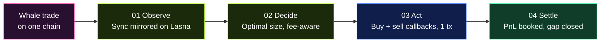
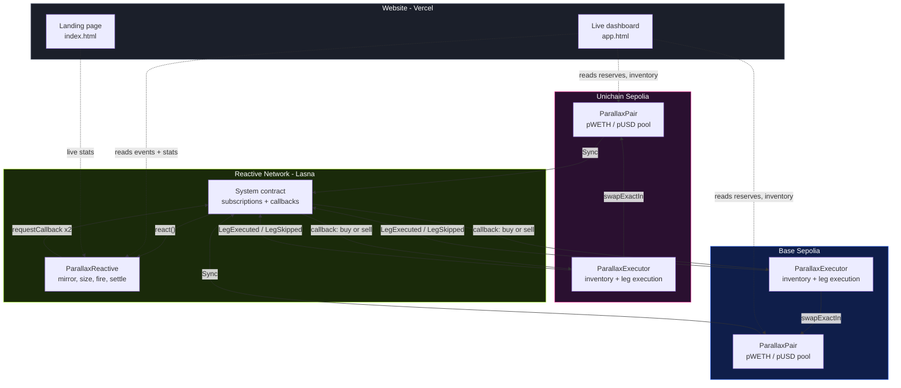
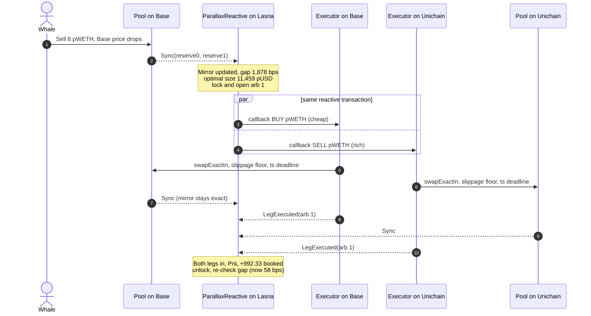
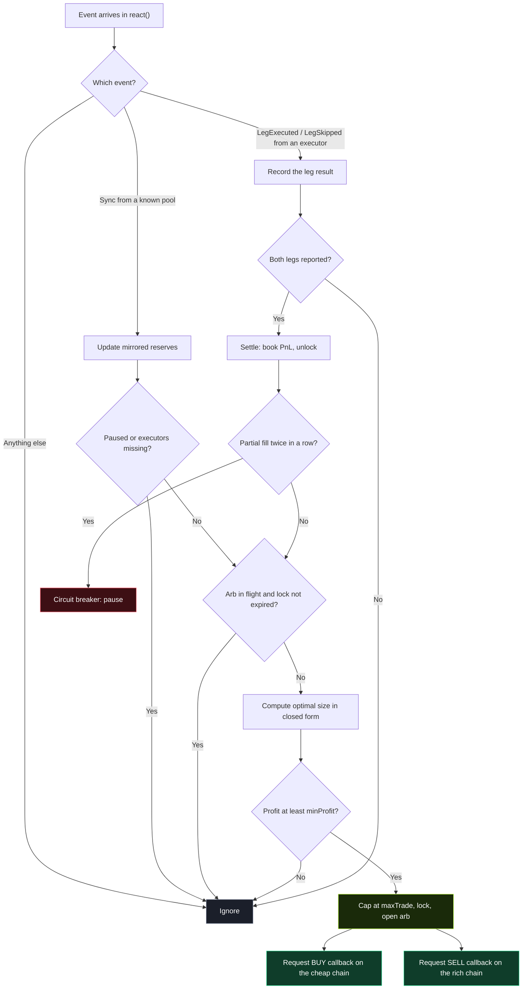
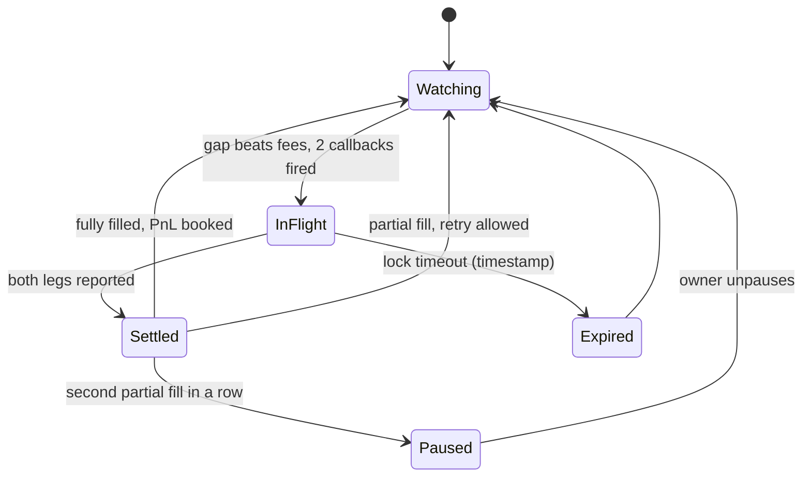
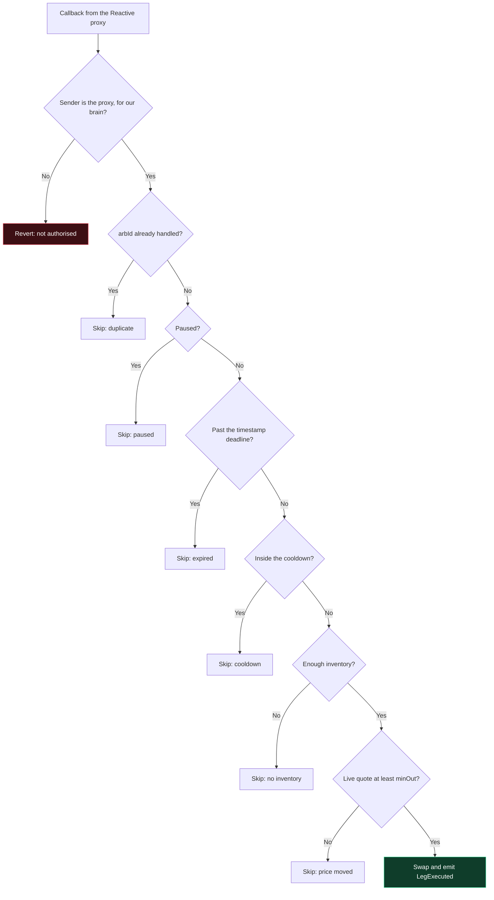
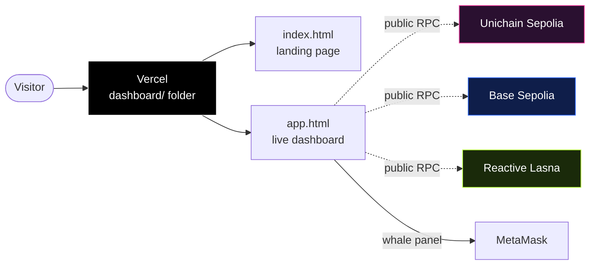

<div align="center">


<br />

### One asset. Two chains. The gap closes itself.

**Reactive cross-chain arbitrage between Unichain and Base, on-chain end to end, powered by Reactive Omni.**

<br />

[](https://parallax-reactive.vercel.app/)
[](https://parallax-reactive.vercel.app/app.html)


<br />

**[Live Site](https://parallax-reactive.vercel.app/)** · **[Live Dashboard](https://parallax-reactive.vercel.app/app.html)** · **[On-chain Proof](#on-chain-proof)** · **[Getting Started](#getting-started)**

<br />

> Built for the **Reactive Omni Buildathon** · Track: **Every Second Counts**

</div>

---

## Table of Contents

- [Overview](#overview)
- [Live Deployment](#live-deployment)
- [On-chain Proof](#on-chain-proof)
- [The Problem and Our Solution](#the-problem-and-our-solution)
- [Key Features](#key-features)
- [How Parallax Works](#how-parallax-works)
- [System Architecture](#system-architecture)
- [Workflow Diagrams](#workflow-diagrams)
  - [The Arbitrage Loop](#the-arbitrage-loop)
  - [Decision Logic](#decision-logic)
  - [Arb Lifecycle](#arb-lifecycle)
  - [Executor Guards](#executor-guards)
- [The Math: Optimal Trade Size](#the-math-optimal-trade-size)
- [Smart Contracts](#smart-contracts)
- [Why Reactive Omni](#why-reactive-omni)
- [Tech Stack](#tech-stack)
- [Project Structure](#project-structure)
- [Getting Started](#getting-started)
  - [Prerequisites](#prerequisites)
  - [Install and Test](#install-and-test)
  - [Fund Your Wallet](#fund-your-wallet)
  - [Deploy the Full Loop](#deploy-the-full-loop)
  - [Configuration](#configuration)
- [Using the Dashboard](#using-the-dashboard)
- [Contract Reference](#contract-reference)
- [Hosting the Site](#hosting-the-site)
- [Deployment Notes](#deployment-notes)
- [Security and Safety](#security-and-safety)
- [Limitations](#limitations)
- [Prototype Snapshot](#prototype-snapshot)
- [Roadmap](#roadmap)
- [Contributing](#contributing)
- [License](#license)
- [Author](#author)

---

## Overview

The same token often trades at different prices on different chains. Whoever closes that gap first keeps the profit. Today that's done by private bot farms running servers, private RPCs and keys on a box.

**Parallax closes the gap with one reactive contract and nothing else.**

1. **Watch.** A reactive contract on **Reactive Network (Lasna)** subscribes to the `Sync` events of a pool on **Unichain Sepolia** and a pool on **Base Sepolia**, and keeps an exact live copy of both.
2. **Decide.** When the price gap is wider than the two 0.3% swap fees, it computes the **profit-maximising trade size in closed form**, on-chain.
3. **Act.** In **one reactive transaction** it fires **two callbacks**: a buy on the cheap chain and a sell on the expensive chain.
4. **Settle.** The executors report back. The brain books realised PnL, releases its lock and immediately re-checks the gap.

On the old ~7 s reactive blocks this strategy was impossible, because the gap was gone before the reaction landed. With **Omni's ~1 s blocks and instant finality**, Parallax closes the gap in **about 2 seconds**.

> Parallax · *the same object, seen from two places, appears shifted. Parallax brings it back into line.*

---

## Live Deployment

| Component | Platform | Address / URL |
|---|---|---|
| **Landing page** | Vercel | [parallax-reactive.vercel.app](https://parallax-reactive.vercel.app/) |
| **Live dashboard** | Vercel | [parallax-reactive.vercel.app/app.html](https://parallax-reactive.vercel.app/app.html) |
| **ParallaxReactive** (the brain) | Reactive Lasna (5318007) | [`0x7CF7EAa45e9AD5a2CAe51B249C2722EFAD001ba2`](https://lasna.reactscan.net/address/0x7CF7EAa45e9AD5a2CAe51B249C2722EFAD001ba2) |
| **ParallaxPair** | Unichain Sepolia (1301) | [`0x17fe4Fb050f91BaB81860632Ed1cF5d979C54833`](https://sepolia.uniscan.xyz/address/0x17fe4Fb050f91BaB81860632Ed1cF5d979C54833) |
| **ParallaxExecutor** | Unichain Sepolia (1301) | [`0xf5b85531bE66956F169735E0745e4644d2EA43ee`](https://sepolia.uniscan.xyz/address/0xf5b85531bE66956F169735E0745e4644d2EA43ee) |
| **ParallaxPair** | Base Sepolia (84532) | [`0x2a32d205717280610E197951b07ba51Aa5510b76`](https://sepolia.basescan.org/address/0x2a32d205717280610E197951b07ba51Aa5510b76) |
| **ParallaxExecutor** | Base Sepolia (84532) | [`0xa3A640A2bD7c1cC3dCad9b5D9e58Fa36F7997A14`](https://sepolia.basescan.org/address/0xa3A640A2bD7c1cC3dCad9b5D9e58Fa36F7997A14) |

> **Testnet only.** pWETH and pUSD are test tokens with no value. Anyone can mint them to play "whale" from the dashboard.

---

## On-chain Proof

**2 arbitrages, one in each direction, 4 of 4 legs filled, +1,341.08 pUSD realised. Each gap closed in about 2 seconds, and each arb realised exactly the profit the contract predicted before firing.**

### ARB #1: buy on Base → sell on Unichain

Gap **1,878 bps → 58 bps** · size **11,459 pUSD** · realised **+992.33 pUSD** · settled in **2 s**

| Step | Chain | Transaction |
|---|---|---|
| ① Whale swap emits `Sync` | Base Sepolia | [`0x17be3a98…51c497`](https://sepolia.basescan.org/tx/0x17be3a987eb44f0387b5bfba52add8b798c4c4ff693f2de2ede8bdd34651c497) |
| ② `react()` fires 2 callbacks in one tx | Reactive Lasna | [`0xa2288808…a8d2f0`](https://lasna.reactscan.net/tx/0xa22888086795a473ea2f962bf1e860596db68753a101f23eeee5f422afa8d2f0) |
| ③ Buy leg: bought 4.343 pWETH (+1 s) | Base Sepolia | [`0x32b8b734…3ea8b8`](https://sepolia.basescan.org/tx/0x32b8b73472897e14f4a990ea6fff61e4471504414f356b0ee5a5b5b2be3ea8b8) |
| ④ Sell leg: sold 4.343 pWETH (+2 s) | Unichain Sepolia | [`0x399a2f4f…24f6cc`](https://sepolia.uniscan.xyz/tx/0x399a2f4f49c82a3439ed166ad4c55786a1062fa0ffab8e5cde640b2f5224f6cc) |

### ARB #2: buy on Unichain → sell on Base

Gap **1,117 bps → 59 bps** · size **6,810 pUSD** · realised **+348.75 pUSD** · settled in **2 s**

| Step | Chain | Transaction |
|---|---|---|
| ① Whale swap emits `Sync` | Unichain Sepolia | [`0x02c2e99d…d52f30`](https://sepolia.uniscan.xyz/tx/0x02c2e99d5a9a8ce87ab82d5fd5ab0e1cb24b00856fb4005b68c13b7d7dd52f30) |
| ② `react()` fires 2 callbacks in one tx | Reactive Lasna | [`0x9c609623…0a8b5f`](https://lasna.reactscan.net/tx/0x9c609623138c429c936dc1e8b195bf7131ed81581d01f21e177bdf7c0a0a8b5f) |
| ③ Buy leg: bought 2.688 pWETH (+2 s) | Unichain Sepolia | [`0x4cd9d6d2…f4eb53`](https://sepolia.uniscan.xyz/tx/0x4cd9d6d2dcd6098df99a6be30111eccb021861af2b0da5f567f47a162af4eb53) |
| ④ Sell leg: sold 2.688 pWETH (+1 s) | Base Sepolia | [`0x2220a3f7…48125f`](https://sepolia.basescan.org/tx/0x2220a3f75c209dd07dabe5d3501ab00d895bb47e5e693fdd12ae1322dd48125f) |

The settlement (`LegConfirmed` ×2 and `ArbSettled`) is recorded in the following reactive transactions on the brain's [Lasna page](https://lasna.reactscan.net/address/0x7CF7EAa45e9AD5a2CAe51B249C2722EFAD001ba2). The live dashboard replays the full history from the deployment block.

---

## The Problem and Our Solution

**The problem**

- Liquidity is split across chains, so every large trade on one chain leaves its twin on another chain mispriced.
- Users on both sides get a worse price until someone closes the gap.
- Closing it today means off-chain bots: servers polling two RPCs, private keys on a machine, retry logic. It's opaque, fragile and closed to almost everyone.
- On ~7-second reactive blocks an on-chain alternative was too slow. The opportunity was gone before the reaction landed.

**Our solution:** move the entire loop on-chain and let Reactive Network drive it.

| Need | How Parallax addresses it |
|---|---|
| See both markets | The reactive contract mirrors both pools from their `Sync` events, with no polling |
| Know when to trade | A fee-aware spread check, with a minimum profit and a maximum trade size |
| Trade the right amount | A closed-form optimal size for two chained constant-product pools |
| Act on both chains at once | Two callbacks requested in the same reactive transaction |
| Avoid double-firing | An in-flight lock, released by executor feedback or a timestamp timeout |
| Survive a bad leg | Skip-and-report legs, partial-fill accounting and a circuit breaker |
| Be fast enough | Reactive Omni: ~1 s blocks and instant finality, so the gap closes in ~2 s |

---

## Key Features

- **Live cross-chain mirror:** exact reserves of both pools, updated on every `Sync`. Compatible with any Uniswap V2-style pair.
- **Closed-form optimal sizing:** the profit-maximising trade is computed on-chain, with no loops or off-chain math.
- **Two callbacks, one transaction:** the buy and sell legs are fired together from a single `react()` call.
- **Closed feedback loop:** the brain subscribes to the executors' `LegExecuted` and `LegSkipped` events.
- **Realised PnL accounting:** per arb and cumulative, plus base-inventory drift.
- **Chained arbs:** after settling, the brain re-checks the gap and fires again if a capped trade left one open.
- **Circuit breaker:** two partial fills in a row pause the engine automatically.
- **Timestamp-based deadlines and cooldowns:** safe on Base Sepolia's 200 ms blocks, as the buildathon rules require.
- **Replay protection and strict authorisation:** only the Reactive callback proxy, acting for this exact brain, can execute a leg, and each `arbId` runs at most once.
- **Landing page and live dashboard:** an animated loop, event ticker, "gap closed in" stopwatch, clickable proof for every step, and a whale panel so anyone can create a gap with MetaMask.
- **One-command deployment:** a single script deploys all 5 contracts across 3 chains and wires them together.
- **29 Foundry tests:** the full loop is simulated, including a fuzz test of the sizing formula.

---

## How Parallax Works

| Step | Stage | Description |
|:---:|---|---|
| **01** | **Observe** | Both pools emit `Sync(uint112,uint112)` on every trade. The brain mirrors reserves on both chains. |
| **02** | **Decide** | If the gap beats fees, the brain computes the optimal size and checks min-profit and max-trade limits. |
| **03** | **Act** | One reactive tx requests two callbacks: **buy** on the cheap chain and **sell** on the rich chain. |
| **04** | **Settle** | Executors swap and report back. The brain books PnL, unlocks and re-checks the gap. |



---

## System Architecture

Parallax consists of two origin/destination markets (one per chain), a reactive brain on Reactive Network, and a static website that reads all three chains directly.



### Components

| Component | Responsibility |
|---|---|
| **ParallaxReactive** (Lasna) | Mirrors both pools, computes spread and optimal size, fires both legs, tracks feedback, books PnL, runs the lock and circuit breaker |
| **ParallaxExecutor** (per chain) | Callback contract holding pWETH and pUSD inventory. Re-quotes, enforces guards, swaps, and emits the result |
| **ParallaxPair** (per chain) | 0.30% constant-product pool that emits the exact Uniswap V2 `Sync` event |
| **ParallaxToken** | pWETH / pUSD test tokens with open minting for the demo |
| **ParallaxMath** | AMM math, closed-form optimal arb size, spread, integer square root |
| **Website** | Static landing page and dashboard. No backend: it reads all three chains via public RPCs |

---

## Workflow Diagrams

### The Arbitrage Loop

The full journey from a whale trade to a settled arbitrage. This is ARB #1, as it ran on-chain.



### Decision Logic

What `react()` does with every event it receives.



### Arb Lifecycle



### Executor Guards

Every leg is checked on the destination chain at the moment it executes. A failed check **skips and reports** instead of reverting: a revert would still be billed and would tell the brain nothing.



---

## The Math: Optimal Trade Size

Buying base on the cheap pool and selling it on the rich pool is a round trip through two chained constant-product pools. Two chained pools behave exactly like **one virtual pool** with reserves:

```
e0 = in1 · in2 / (in2 + γ · out1)
e1 = γ · out1 · out2 / (in2 + γ · out1)        γ = 997 / 1000  (0.3% fee)
```

The profit `P(dx) = γ·e1·dx / (e0 + γ·dx) − dx` is concave, so setting `P'(dx) = 0` gives the exact optimum:

```
dx* = ( √(γ · e0 · e1) − e0 ) / γ         profitable only if γ · e1 > e0
```

`ParallaxMath.optimalArbInput` implements this in integer math. Reserves are bounded by `uint112`, so every product fits in `uint256`. The fuzz test `testFuzz_optimalIsLocalMaximum` checks that ±1% around `dx*` is never better. In ARB #1 the formula picked 11,459 pUSD, the realised profit matched the prediction to the wei, and the gap landed inside the fee band at 58 bps.

---

## Smart Contracts

All contracts are written in **Solidity 0.8.30**, built with **Foundry**, and use the official **[reactive-lib-omni](https://github.com/Reactive-Network/reactive-lib-omni)**.

| Contract | File | Chain |
|---|---|---|
| `ParallaxReactive` | `src/ParallaxReactive.sol` | Reactive Lasna |
| `ParallaxExecutor` | `src/ParallaxExecutor.sol` | Unichain Sepolia, Base Sepolia |
| `ParallaxPair` | `src/amm/ParallaxPair.sol` | Unichain Sepolia, Base Sepolia |
| `ParallaxToken` | `src/amm/ParallaxToken.sol` | Unichain Sepolia, Base Sepolia |
| `ParallaxMath` | `src/ParallaxMath.sol` | library |

### Event topics the brain subscribes to

| Event | Emitted by | topic0 |
|---|---|---|
| `Sync(uint112,uint112)` | both pools | `0x1c411e9a96e071241c2f21f7726b17ae89e3cab4c78be50e062b03a9fffbbad1` (Uniswap V2) |
| `LegExecuted(uint256,bool,uint256,uint256)` | both executors | `keccak256` of the signature |
| `LegSkipped(uint256,uint8)` | both executors | `keccak256` of the signature |

### Reactive callback proxies

| Chain | Callback proxy |
|---|---|
| Unichain Sepolia | `0x775c9B990ADe401060B78D0e98684eEf8d2466C1` |
| Base Sepolia | `0x476F44b11F5C942c58f4c8E3d0300E5710743585` |

---

## Why Reactive Omni

| | Reactive (legacy) | Reactive Omni | Parallax loop |
|---|---|---|---|
| Block time | ~7 s | **~1 s** | |
| Finality | probabilistic | **instant (CometBFT)** | |
| Gap opened → both legs filled | too slow to compete | | **~2 s** |

Arbitrage is a race against other traders and against the price drifting back. Omni makes the reaction land while the opportunity is still there. Parallax also follows the buildathon rule for Base Sepolia's **200 ms blocks**: every deadline and cooldown uses `block.timestamp`, never block counts.

---

## Tech Stack

| Layer | Technology |
|---|---|
| **Reactive layer** | Reactive Network Omni (Lasna testnet), `reactive-lib-omni` |
| **Destination chains** | Unichain Sepolia, Base Sepolia |
| **Smart contracts** | Solidity 0.8.30 (via-IR, Paris EVM target), Foundry, forge-std |
| **Testing** | Foundry unit, integration and fuzz tests with a mock system contract |
| **Frontend** | Static HTML, CSS and JavaScript, ethers v6, MetaMask for the whale panel |
| **Automation** | Bash + `forge script` / `forge create` / `cast` |
| **CI** | GitHub Actions (`forge build` + `forge test`) |
| **Hosting** | Vercel (static site, root `dashboard/`) |

---

## Project Structure

```text
parallax-reactive/
├── assets/
│   └── logo.svg                    Project logo (README)
├── src/
│   ├── ParallaxReactive.sol        The brain: mirror, size, fire, settle
│   ├── ParallaxExecutor.sol        Callback contract, one per chain
│   ├── ParallaxMath.sol            AMM math + closed-form optimal size
│   ├── amm/
│   │   ├── ParallaxPair.sol        Constant-product pool (Uniswap V2 Sync)
│   │   └── ParallaxToken.sol       pWETH / pUSD test tokens
│   └── interfaces/
├── test/
│   ├── Parallax.t.sol              Full-loop simulation (23 tests)
│   ├── ParallaxMath.t.sol          Math + fuzz tests (6 tests)
│   └── mocks/MockSystem.sol        Stand-in for the Reactive system contract
├── script/
│   ├── DeployOrigin.s.sol          Tokens + seeded pool on one chain
│   ├── DeployExecutor.s.sol        Executor + gas + inventory on one chain
│   └── Whale.s.sol                 Create a price gap for demos
├── scripts/
│   ├── setup.sh                    Install deps, build, test
│   ├── deploy-all.sh               6-step deployment across 3 chains
│   ├── whale.sh                    ./scripts/whale.sh base dump 8
│   ├── status.sh                   Markets, brain, executors at a glance
│   └── write-dashboard-config.sh   Generates dashboard/config.js
├── dashboard/                      Static website (Vercel root)
│   ├── index.html                  Landing page
│   ├── app.html                    Live dashboard
│   ├── config.js                   Public addresses + RPCs (generated)
│   ├── logo.svg · favicon.svg · og.png
├── deployments/                    Addresses written by the deploy scripts
├── broadcast/                      Foundry broadcast logs (tx evidence)
├── .github/workflows/ci.yml
├── foundry.toml · remappings.txt · Makefile · .env.example
└── SUBMISSION.md                   Buildathon checklist + demo script
```

---

## Getting Started

### Prerequisites

- **Foundry:** `curl -L https://foundry.paradigm.xyz | bash && foundryup`
- **Git** and **Python 3** (for the local site server)
- On Windows, use **WSL 2 (Ubuntu)**
- One **testnet-only** wallet. Never use a key that holds real funds.

### Install and Test

```bash
git clone --recurse-submodules https://github.com/Hajrajadoon/parallax-reactive.git
cd parallax-reactive
./scripts/setup.sh          # installs forge-std + reactive-lib-omni, builds, runs 29 tests
```

Expected result: `29 tests passed, 0 failed`.

### Fund Your Wallet

| Chain | Need | Where |
|---|---|---|
| Base Sepolia | ~0.02 ETH | Superchain faucet (`console.optimism.io/faucet`), Bware Labs, or bridge from Sepolia |
| Unichain Sepolia | ~0.001 ETH | Superchain faucet, or bridge Sepolia → Unichain Sepolia on `testnets.superbridge.app` |
| Reactive Lasna | ~0.8 lREACT | Send Base Sepolia ETH to the Reactive faucet (1 ETH = 100 lREACT) |

```bash
# 0.008 Base Sepolia ETH -> 0.8 lREACT on Lasna
cast send 0x2afaFD298b23b62760711756088F75B7409f5967 "request(address)" <YOUR_ADDRESS> \
  --value 0.008ether --rpc-url https://sepolia.base.org --private-key <YOUR_KEY>
```

### Deploy the Full Loop

```bash
cp .env.example .env        # set PRIVATE_KEY=0x...
./scripts/deploy-all.sh     # or one step at a time: ./scripts/deploy-all.sh 1 ... 6
```

| Step | What it deploys | Chain |
|:---:|---|---|
| 1 | pWETH, pUSD, seeded pool | Unichain Sepolia |
| 2 | pWETH, pUSD, seeded pool | Base Sepolia |
| 3 | `ParallaxReactive` (subscribes to both `Sync` events) | Reactive Lasna |
| 4 | `ParallaxExecutor` + gas + inventory | Unichain Sepolia |
| 5 | `ParallaxExecutor` + gas + inventory | Base Sepolia |
| 6 | `configureExecutors()` (subscribes to leg events) | Reactive Lasna |

Then fund the brain, open the site and create a gap:

```bash
cast send <REACTIVE_ADDR> --value 0.4ether --rpc-url $REACTIVE_RPC --private-key $PRIVATE_KEY
make dashboard                       # http://localhost:8090 · dashboard: /app.html
./scripts/whale.sh base dump 8       # sell 8 pWETH on Base, ~16% gap
./scripts/status.sh                  # markets, brain, executors
```

### Configuration

All settings live in `.env` (see `.env.example`). Never commit `.env`: it's in `.gitignore`.

| Variable | Default | Meaning |
|---|---|---|
| `PRIVATE_KEY` | none | Testnet-only deployer key. **Secret.** |
| `UNICHAIN_SEPOLIA_RPC` / `BASE_SEPOLIA_RPC` / `REACTIVE_RPC` | public RPCs | Endpoints for the three chains |
| `REACTIVE_FUND` | `0ether` | lREACT sent with the deploy (top up afterwards instead) |
| `MIN_PROFIT_WEI` | 5 pUSD | Don't fire below this expected profit |
| `MAX_TRADE_WEI` | 100,000 pUSD | Risk cap per arb (a capped trade chains into a follow-up arb) |
| `SLIPPAGE_BPS` | 100 | minOut floor applied to each leg |
| `LEG_TTL` | 60 s | Timestamp deadline for each leg |
| `LOCK_TIMEOUT` | 120 s | An in-flight arb stops blocking new ones after this |
| `EXECUTOR_GAS_FUND` | 0.0002 ETH | Prepaid callback gas per executor (~100 callbacks) |
| `EXECUTOR_COOLDOWN` | 2 s | Minimum time between legs on one executor |
| `INVENTORY_BASE` / `INVENTORY_QUOTE` | 50 pWETH / 150,000 pUSD | Trading inventory per executor |

The owner can retune live with `setParams(...)`, `setPaused(bool)` and `resetLock()`.

---

## Using the Dashboard

1. Open the **[live dashboard](https://parallax-reactive.vercel.app/app.html)**. Prices, inventory and the full arb history load straight from the chains.
2. In the **🐋 Whale panel**, pick a market and action, enter an amount and press **Unleash the whale**. MetaMask mints free test tokens, approves and swaps.
3. Watch the **reactive loop**: a pulse travels from the pool to the brain, then the two callbacks fly out to both chains.
4. A new **ARB card** appears with all four steps as clickable transactions, and the stopwatch shows how fast the gap closed.

| Section | What it shows |
|---|---|
| **LIVE ticker** | Every `Sync`, arb, leg and settlement as it happens |
| **Venue cards** | Price, reserves, executor inventory, callback gas, legs ok / skipped |
| **Cross-chain spread** | Live gap in bps vs the 60 bps fee band, plus the brain's mirrored gap |
| **Reactive loop** | Animated diagram of the origin → reactive → callbacks flow |
| **Stats** | Arbs fired, legs filled, realised PnL, detect → fire, fire → settled |
| **Arbitrage feed** | Every arb with origin, reactive and both leg transactions and timings |

---

## Contract Reference

### `ParallaxReactive`

| Function | Access | Description |
|---|---|---|
| `react(LogRecord)` | system only | Entry point for subscribed events |
| `previewArb()` | view | What it would trade right now: venue, size, expected out, profit |
| `currentSpreadBps()` | view | Gap between the mirrored prices |
| `isLocked()` | view | Whether an arb is in flight |
| `venueA()` / `venueB()` | view | Mirrored reserves, pool, executor, last update |
| `arbs(id)` | view | Per-arb record: size, legs, PnL, settled |
| `configureExecutors(a, b)` | owner, once | Wire executors and subscribe to their events |
| `setParams(...)` | owner | Min profit, max trade, slippage, leg TTL, lock timeout |
| `setPaused(bool)` / `resetLock()` | owner | Manual controls |
| `coverDebt()` | anyone | Settle debt with the system contract |

**Events:** `PriceObserved`, `ArbOpened`, `LegConfirmed`, `LegFailed`, `ArbSettled`, `ArbExpired`, `CircuitBreakerTripped`.

### `ParallaxExecutor`

| Function | Access | Description |
|---|---|---|
| `executeLeg(rvm, arbId, buyBase, amountIn, minOut, deadline)` | callback proxy, for our brain | Run one leg with all guards |
| `inventory()` | view | pWETH, pUSD and native balance |
| `setPaused` / `setCooldown` / `withdrawToken` / `withdrawNative` | owner | Management |
| `coverDebt()` | anyone | Settle callback debt with the proxy |

**Events:** `LegExecuted(arbId, buyBase, amountIn, amountOut)` and `LegSkipped(arbId, reason)`, where the reason is one of `Paused`, `Expired`, `Cooldown`, `InsufficientInventory`, `PriceMoved`, `SwapFailed` or `Duplicate`.

---

## Hosting the Site

`dashboard/` is a static site with no build step.



| Setting (Vercel) | Value |
|---|---|
| Root directory | `dashboard` |
| Framework preset | Other |
| Build command | *(none)* |

On Netlify, you can instead drag the `dashboard/` folder onto Netlify Drop. `config.js` contains only public addresses and RPC URLs, never keys.

---

## Deployment Notes

Things we learned deploying on Lasna that will save you time:

- **Lasna gas is ~100 gwei.** Deploying the brain costs ~0.22 lREACT. Deploy with `REACTIVE_FUND=0` and top up with a plain transfer afterwards. Sending value with the deploy can make `eth_estimateGas` fail with *"contract creation code storage out of gas"*.
- **Fund the brain before the pools trade.** If an event arrives while the contract holds 0 lREACT, it goes into debt and Reactive pauses it. Call `coverDebt()`, then make a tiny swap on each pool so the mirror picks up fresh reserves.
- **Addresses are deterministic per wallet nonce**, so you can deploy the brain against a pool address before that pool exists (useful when one chain's faucet is slow).
- **Dashboard history:** `write-dashboard-config.sh` stores the brain's deployment block in `config.js`, so the dashboard replays every arb since launch.

---

## Security and Safety

- **Authorisation:** executors accept calls only from the Reactive callback proxy *and* only on behalf of this exact `ParallaxReactive` (`onlyServiceProvider` + `onlyCallbackSender`).
- **Replay protection:** each `arbId` executes at most once per executor.
- **Live re-quote:** each leg re-prices against the pool, and if the price moved past `minOut` the leg is skipped, never forced.
- **Timestamp deadlines and cooldowns:** no block counting, which is safe on 200 ms blocks.
- **In-flight lock:** the brain never double-fires on the `Sync` events its own legs create.
- **Circuit breaker:** two consecutive partial fills pause the engine.
- **Keys:** the deployer key lives only in `.env`, which `.gitignore` excludes. The website never holds keys, and the whale panel signs through MetaMask.
- **Reentrancy:** the pool uses a lock modifier, and the executor's swap path is wrapped in `try/catch`.

---

## Limitations

- **Testnet only.** pWETH and pUSD have no value, and testnets can be reset.
- **Inventory-based.** Each executor holds both assets so no bridge sits in the hot path. Inventory drifts toward one chain over time, and rebalancing is manual.
- **The legs are not atomic.** They are coordinated and guarded. A partial fill is detected, accounted for and bounded by the circuit breaker, but it can still happen.
- **Demo AMM.** `ParallaxPair` has one-way liquidity (no LP token). The brain itself works with any Uniswap V2-style `Sync`.
- **Single pair, two venues.** More assets or venues would need a reactive contract per pair or a generalised mirror.

---

## Prototype Snapshot

State of the live deployment at the time of writing (November 2026):

| Metric | Value |
|---|---|
| Contracts deployed | 5, across 3 chains |
| Arbs fired | 2 (one in each direction) |
| Legs filled | 4 / 4 |
| Realised PnL | **+1,341.08 pUSD** |
| Gap opened → both legs filled | ~2 s |
| Foundry tests | 29 passing (including fuzz) |

---

## Roadmap

- [x] Reactive brain mirroring two chains from `Sync` events
- [x] Closed-form optimal sizing on-chain
- [x] Two callbacks per reactive transaction, with executor feedback loop
- [x] Lock, chained arbs, partial-fill accounting, circuit breaker
- [x] Timestamp deadlines and cooldowns (Base 200 ms blocks)
- [x] 29 Foundry tests including fuzz
- [x] One-command deployment across 3 chains
- [x] Landing page and live dashboard with whale panel
- [ ] Router-backed executors for real Uniswap V2 / V4 pools
- [ ] Automatic inventory rebalancing via a bridge, off the hot path
- [ ] More pairs and more venues (Ethereum Sepolia, OP Sepolia)
- [ ] Dynamic fees and gas-aware minimum profit
- [ ] Mainnet deployment with audited contracts

---

## Contributing

Contributions, ideas and feedback are welcome.

1. Fork the repository
2. Create a feature branch: `git checkout -b feature/your-feature`
3. Run the tests: `forge test`
4. Commit your changes: `git commit -m "Add your feature"`
5. Push the branch and open a Pull Request

> Never commit `.env` files or private keys.

---

## License

This project is released under the **MIT License**. See [`LICENSE`](./LICENSE).

---

## Author

Built by **[Hajrajadoon](https://github.com/Hajrajadoon)** for the **Reactive Omni Buildathon** (November 5 – December 5, 2026).

---

<div align="center">

**[Live Site](https://parallax-reactive.vercel.app/)** · **[Live Dashboard](https://parallax-reactive.vercel.app/app.html)** · **[Reactive Network](https://dev.reactive.network)**

**Parallax** · One asset. Two chains. The gap closes itself.

*Testnet prototype · Not financial advice*

</div>
